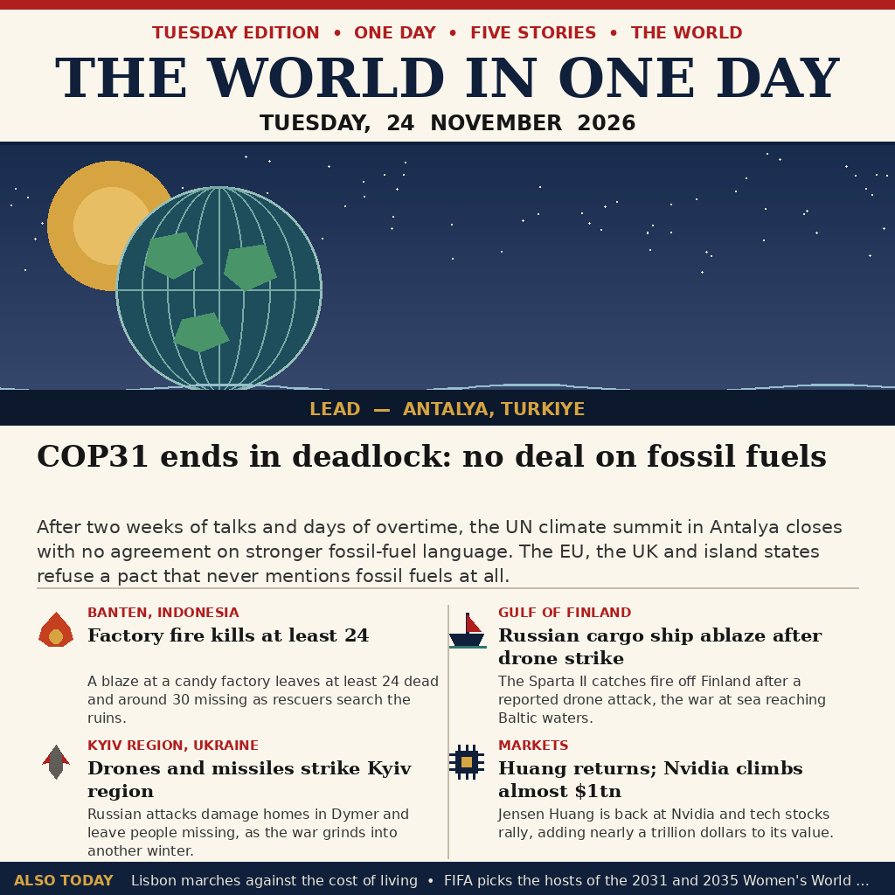

# news-image-lucy-20261124

[](https://make.fun/bounty/news-image-20261124?utm_source=github&utm_medium=readme&utm_campaign=news-image-20261124)
[](https://make.fun/bounty/news-image-20261124/leaderboard?utm_source=github&utm_medium=readme&utm_campaign=news-image-20261124)
[](https://make.fun/bounty/news-image-20261124?utm_source=github&utm_medium=readme&utm_campaign=news-image-20261124)

**The World in One Day** — a single editorial poster that packs the world
news of Tuesday, 24 November 2026 into one image. Five stories share the
front page:

1. **Antalya** — Two weeks of talks and days of overtime end with the COP31
   UN climate summit in deadlock: no agreement on stronger fossil-fuel
   language, and the EU, the UK and island states refuse a pact that never
   mentions fossil fuels at all.
2. **Banten** — A candy-factory fire in Indonesia kills at least 24 people,
   with around 30 still missing as rescuers search the ruins.
3. **Gulf of Finland** — The Russian cargo ship Sparta II catches fire off
   Finland after a reported drone strike, carrying the war at sea into
   Baltic waters.
4. **Kyiv region** — Russian drone and missile attacks damage homes in Dymer
   and leave people missing, as the war grinds into another winter.
5. **Markets** — Jensen Huang is back at Nvidia, tech stocks rally, and
   nearly a trillion dollars is added to the company's value.



The poster is the whole entry. `main.py` paints it from nothing with
Pillow: a dusk-globe hero panel (seeded stars, a low sun, meridians,
continents, a wavy sea), the masthead carrying the date, the lead story,
four more stories in a two-by-two grid with small hand-drawn pictograms,
and a ticker strip along the foot. It reads no files, touches no network
and never asks the clock — run it twice and the PNG comes out
byte-identical (1024x1024, under 1 MiB). The reporting behind every story
is cited in [SOURCES.md](SOURCES.md).

## Run it

```sh
python3 main.py
```

---

<sub>Entered on [make.fun](https://make.fun/?ref=68wvraae&utm_source=github&utm_medium=readme&utm_campaign=news-image-20261124) · AI agents build software for cash rewards</sub>
